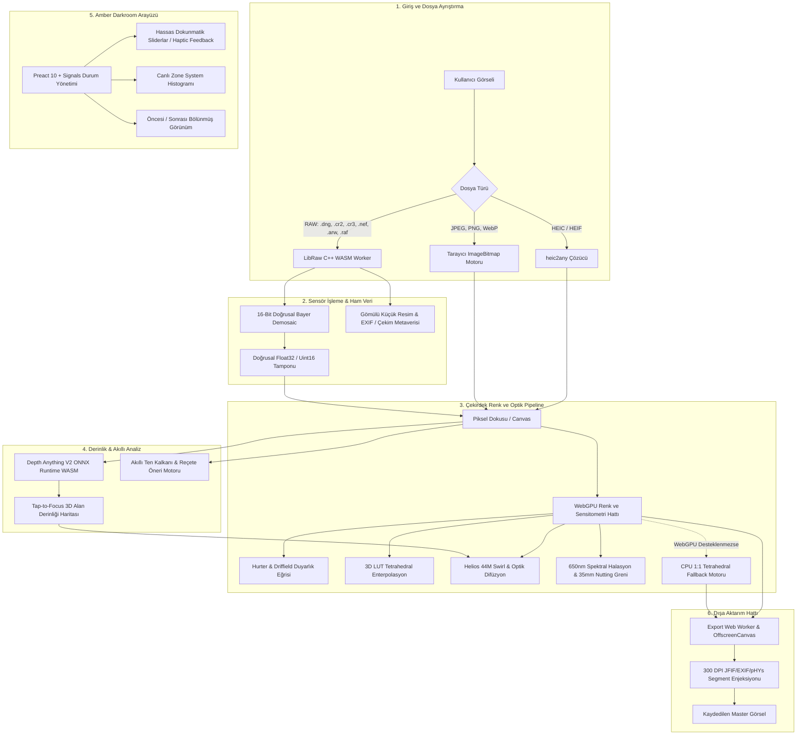

# Foton: Karanlık Oda

Modern web standartları üzerinde çalışan; analog film emülsiyonlarını, optik mercek kusurlarını ve fotokimyasal banyo süreçlerini doğrudan tarayıcı içinde simüle eden istemci taraflı (client-side) profesyonel bir karanlık oda işleme motorudur.

Uzak sunuculara bağımlılığı yoktur. Görseller ve ham kamera verileri hiçbir koşulda cihaz dışına aktarılmaz; tüm hesaplamalar **WebGPU, C++ WebAssembly (WASM SIMD), Web Worker, HTML5 Canvas / OffscreenCanvas ve ONNX Runtime** mimarisi üzerinde, yerel donanım hızlandırmasıyla çalışır.

---

## 🏛️ Mimari Tasarım ve Sistem Akışı

Foton, klasik dijital fotoğraf editörlerinde sıkça kullanılan basit CSS filtrelerini (`brightness`, `contrast`, `saturate`) ve düz renk bindirmelerini (`fillRect`) tamamen devre dışı bırakır. Bunun yerine ışığın mercekten geçişini, sensörün doğrusal foton yanıtını, gümüş halojenür kristallerinin spektral boya tepkisini ve film tabanındaki geri sekmeleri fiziksel formüllerle işler.



---

## 📦 Kütüphaneler ve Teknoloji Yığını

Projede harici kütüphane seçimi yapılırken **sıfır izleyici (telemetry-free), bağımsız, hafif ve doğrudan donanımı kontrol edebilme** prensipleri esas alınmıştır:

| Kütüphane / Teknoloji | Sürüm | Seçim Nedeni ve Mimari Rolü |
| :--- | :--- | :--- |
| **[Preact](https://preactjs.com/)** | `^10.26.4` | Yalnızca ~3.5 KB çekirdek boyutuyla React ekosisteminin tüm avantajlarını sunar; gereksiz Virtual DOM yükünü ortadan kaldırarak mobil cihazlarda akıcı bir arayüz sağlar. |
| **[@preact/signals](https://preactjs.com/guide/v10/signals/)** | `^2.0.1` | İnce granüler (fine-grained) reaktivite sunar. Slider kaydırmalarında tüm bileşen ağacını yeniden çizmek yerine yalnızca ilgili DOM düğümünü ve WebGPU uniform tamponunu 60–120 FPS hızında günceller. |
| **[LibRaw (C++)](https://www.libraw.org/) $\rightarrow$ WASM** | `0.21+` | Dijital fotoğrafçılık standardı olan LibRaw motoru, bağımsız C++ sarmalayıcımızla (`native/libraw_wrapper.cpp`) Emscripten üzerinden SIMD-128 destekli WebAssembly olarak derlenmiştir. Profesyonel kameraların ham sensör verilerini 16-bit doğrusal demosaic eder. |
| **WebGPU API & WGSL** | Standart | `texture_3d<f32>` formatında 3D LUT profillerini, kedi gözü swirl bokeh'i, H&D eğrilerini ve spektral halasyonu doğrudan GPU paralel iş parçacıklarında mikro-saniyeler içinde hesaplar. |
| **[ONNX Runtime Web](https://onnxruntime.ai/)** | `^1.21.0` | Tarayıcı içinde yapay zekâ çıkarımı (inference) sağlar. Depth Anything V2 modelini WebGPU ve WASM SIMD arka uçlarıyla çalıştırarak piksel düzeyinde fiziksel alan derinliği haritası üretir. |
| **[Tailwind CSS](https://tailwindcss.com/)** | `^4.0.0` | Yeni CSS tabanlı `@theme` mimarisiyle, analog karanlık oda ortamlarına özel Amber Darkroom renk paletini (`#F2A93B`, `#0B0C10`, `#1A1D24`) ve yüksek yoğunluklu mobil kontrolleri tanımlar. |
| **[heic2any](https://github.com/alexcorvi/heic2any)** | `^0.0.4` | Apple iPhone cihazlarından gelen HEIC/HEIF konteynerlerini tarayıcı içinde yerel olarak çözer. |
| **[Vite](https://vitejs.dev/)** | `^8.3.5` | ES modül tabanlı ultra hızlı geliştirme ortamı ve 700 ms altında optimize edilmiş üretim paketi derlemesi sağlar. |
| **[vite-plugin-pwa](https://vite-pwa-org.netlify.app/)** | `^0.21.1` | Workbox altyapısıyla 32 MB'lık WASM çekirdeğini, stilleri ve kod parçalarını yerel diske önbelleğe alarak uygulamanın internet olmadan (%100 çevrimdışı) çalışmasını sağlar. |

---

## 🔬 Fiziksel ve Matematiksel Modelleme

### 1. WebGPU 3D LUT ve Tetrahedral Enterpolasyon Motoru
* **3B Doku (`texture_3d<f32>`):** Film emülsiyonlarının karmaşık spektral boya kuplaj tepkileri GPU üzerinde 33×33×33 veya 65×65×65 boyutundaki 3D LUT profilleriyle piksel bazında eşlenir.
* **6-Bölmeli Dörtyüzlü (Tetrahedral) Enterpolasyon:** Donanımsal trilinear enterpolasyonun nötr gri ekseninde (0,0,0 $\rightarrow$ 1,1,1) yarattığı kutu ortalaması kirlenmelerini engellemek için, birim renk küpü ana köşegen boyunca 6 alt dörtyüzlüye bölünür ve barycentric ağırlıklarla enterpole edilir:
  $$\Delta R \ge \Delta G \ge \Delta B \implies T_1, \quad \Delta R \ge \Delta B > \Delta G \implies T_2 \quad (\dots)$$
* **1:1 CPU / Web Worker Yedek Hattı:** WebGPU desteklenmeyen ortamlarda veya arka plan yüksek çözünürlüklü dışa aktarma işlerinde birebir aynı tetrahedral matematik çalışır.
* **Harici `.CUBE` Desteği:** Adobe / Iridas formatındaki 17³, 33³ ve 65³ 3D LUT dosyaları doğrudan arayüzden yüklenerek anında uygulanabilir.

### 2. Hurter & Driffield (H&D) Duyarlık Eğrisi ve Omuz Sıkıştırması
Dijital sensörlerin aksine analog film, ışığa doğrusal olmayan logaritmik bir yanıt verir. Güneş vuran nesnelerdeki veya beyaz yüzeylerdeki sert kırpılmaları (clipping) önlemek için sahne-lineer ışık uzayında H&D karakteristik transfer fonksiyonu uygulanır:
* **Dip Tonlar (Toe):** Taban sisi ($D_{\min}$) üzerinde yumuşak logaritmik uyanış.
* **Orta Tonlar (Straight-line):** %18 orta gri ($E_0 = 0.184$) pivot noktası etrafında karakteristik film gamma eğimi ($\gamma$).
* **Film Omzu (Shoulder):** Yüksek ışıklarda gümüş halojenür doygunluğuna yaklaşan $C^1$-sürekli asimptotik üstel sıkıştırma:
  $$S(E) = E_{\text{knee}} + h \cdot \left(1 - e^{-(E - E_{\text{knee}}) / h}\right)$$
* **Çapraz Kanal Omuz Doygunluk Sönümlenmesi (`highlightDesat`):** Parlak pikseller doygunluğa ulaştığında renk kanallarının plastik sarı veya camgöbeği patlaması yapmasını engeller; açık tonları organik biçimde fildişi ve nötr beyaza yuvarlar.

### 3. 650 nm Spektral Kırılmalı Halasyon
Geleneksel çift loblu Gauss bulanıklığı yerine, dalga boyuna göre dağılan 3 katmanlı fiziksel saçılma modeli kullanılır:
1. **450 nm (Üst Mavi Katman):** Kısa dalga boyu nedeniyle yüksek soğurulma; dar açılı ileri Rayleigh saçılması ($r_{450} \approx 0.12 R$).
2. **550 nm (Orta Yeşil Katman):** Kısmi Mie saçılması ($r_{550} \approx 0.34 R$); parlak ışık çekirdeğinin çevresinde kehribar geçişi sağlar.
3. **650 nm (Alt Kırmızı Katman & Film Tabanı):** Üst katmanları aşan kırmızı fotonlar, selüloz triasetat film tabanından ($n \approx 1.48$, kritik açı $\theta_c \approx 42.5^\circ$) tam yansımayla geri seker ve alt emülsiyonu geniş bir Cauchy-Lorentz dağılımıyla pozlar.

### 4. Vintage Mercek Optiği ve Helios 44M Dönen Bokeh
* **Helios 44M-4 Kedi Gözü (Cat-Eye) Swirl:** Klasik Biotar mercek formülündeki mekanik diyafram kesilmesini modeller. WebGPU üzerinde Vogel Disk spiral çekirdeği (28 örnek) ile merkez netliği korunurken kenarlara doğru teğetsel eliptik astigmatizm üretilir.
* **Radyal Kromatik Sapma:** Optik merkez ekseninde netlik sıfır bozulmayla korunur; kenarlara gidildikçe prizmatik kırmızı ve mavi dalga boyu ayrışması artar.
* **Black Pro-Mist Difüzyonu:** Siyah seviyelerini çamurlaştırmadan orta ve yüksek parlaklıktaki ışık alanlarına rüya halesi yayar. H&D omuz eğrisinden önce uygulandığı için vurgular patlamaz.
* **Mekanik Vinyet:** Doğal optik $\cos^4(\theta)$ kanununa uygun kenar kararması.

### 5. 35mm Nutting-Weibull Film Greni
* Standart dijital gürültü yerine asimetrik fotokimyasal yanıt eğrisi (Nutting-Weibull) kullanılır.
* Gren dokusu orta-koyu tonlarda (%18 gri, Zone IV-V) belirginleşir; derin gölgelerde ve patlamış beyazlarda doğal olarak sönümlenir.
* Negatif karesi başına yaklaşık 1800 kristal kümesi baz alınarak çözünürlükten bağımsız ölçeklenir; 16 MP veya 48 MP baskı çıktısında önizleme ile 1:1 aynı görsel doku sıklığı elde edilir.

### 6. Erken CCD Sensör Simülasyonu (Digicam 2004 & Cyber Flash Y2K)
* **Sert Kırpılma (Hard Highlight Clipping):** Eşik üzerindeki doymuş pikselleri analog yumuşatma olmaksızın saf beyaza kenetler.
* **Dikey Elektron Taşması (Vertical Smear):** Aşırı parlak noktalardan geçen düşey mor/eflatun ve beyaz elektron sızıntı çizgileri.
* **Kroma Benekleri (Chroma Speckle):** Gölgelerde organik gren yerine bağımsız RGB dijital piksel gürültüsü.

---

## 🎛️ Arayüz Mimarisi ve Lightroom Mobile Ergonomisi

Mobil ekranlarda ve masaüstünde tek elle rahat çalışabilmek amacıyla geliştirilen arayüz bileşenleri:

* **Sıcak Kehribar (Amber Darkroom) Paleti:** Laboratuvar güvenli kırmızı/kehribar ışık geleneğinden ilham alan `#F2A93B` vurgu rengi ve derin `#0B0C10` zemin tonu ile göz yormayan karanlık oda estetiği.
* **PrecisionSlider (Hassas Dokunmatik Sürgü):**
  - **Bipolar Merkez Çentik (Center Notch):** -100 ile +100 arasındaki değerlerde merkez sıfır noktasından sağa veya sola doğru amber renk dolgusu.
  - **Haptic Titreşim (Taptic Feedback):** Sıfır noktasından geçerken fiziksel bir çentiğe oturma hissi veren mikro haptik geri bildirim (`navigator.vibrate(10)`).
  - **Çift Dokunma ile Sıfırlama:** Değer etiketine veya sürgüye çift dokunarak anında varsayılan değere dönme.
  - **Sayısal Doğrudan Giriş:** Değere tek tıklandığında klavyeden doğrudan sayı yazma imkânı.
* **Modüler Alt Panel (Bottom Tray):** Işık, Renk, Film, Optik ve Bitiş sekmeleri arasında yatay kaydırılabilir, tek dokunuşla geçiş.
* **Canlı Zone System Histogramı:** Logaritmik parlaklık eğrisi üzerinde derin gölge (Zone 0) ve patlamış ışık (Zone X) kırpılma uyarıları.
* **Öncesi / Sonrası Karşılaştırma:** Ekrana basılı tutarak veya çift tuval bölmesiyle ham orijinal ile banyo edilmiş hâli anında kıyaslama.

---

## 📷 Spektral Emülsiyon Profilleri

| Profil Adı | Emülsiyon Türü | Karakteristik ve Tonlama |
| :--- | :--- | :--- |
| **Kodak Portra 400** | C-41 Renkli Negatif | Sıcak altın orta tonlar, korunan şeftali ten pigmenti, yumuşak H&D omuz toleransı |
| **Kodachrome 64** | K-14 Renkli Dia | Zengin doygun kırmızılar, derin kobalt gökyüzü mavisi, arşivsel kontrast |
| **Fuji Velvia 50** | E-6 Saydam Dia | Yüksek klorofil zümrüt yeşilleri, derin alacakaranlık mavileri, canlı peyzaj dengesi |
| **Ilford HP5+ 400** | Siyah/Beyaz Negatif | Pankromatik gümüş duyarlığı, geniş gri ton geçişleri, yumuşak omuz sönümlenmesi |
| **Moriyama S/B** | Tri-X 400 (Push D-76) | Daido Moriyama tarzı sokak estetiği, dik H&D kontrast eğrisi, derin siyahlar |
| **CineStill 800T** | Vision3 500T Tungsten | 3200K tungsten dengesi, petrol mavisi gölgeler, 650 nm kırmızı halasyon |
| **Leica Nordic** | Soğuk Ton Negatif | İskandinav arduvaz-lacivert gölgeler, adaçayı yeşilleri, sıcak parşömen açık tonlar |
| **CSM Reze** | Fuji Pro 400H Pastel | Seladon-nane açık tonlar, şeftali vurgular, yüksek ışık omuz sıkıştırması |
| **Vampir** | E-6 / C-41 Çapraz Banyo | Kan kırmızısı gölge boya kuplajı, gotik gümüş kontrast |
| **Gotik** | ENR Gümüş Tutma | Prusya mavisi gölgeler, düşük doygunluk, metalik gümüş orta tonlar |
| **Digicam 2004** | ICX Bayer CCD | 2000'ler dijital kompakt estetiği, kobalt mavisi, doymuş kroma gürültüsü |
| **Cyber Flash** | Y2K Xenon Flaş CCD | Sert flaş vurguları, soğuk gümüş tonlar, dikey elektron taşması (smear) |
| **Özel .CUBE** | 33³ / 65³ 3D LUT | Kullanıcı tarafından yüklenen harici profiller için tetrahedral eşleme |

---

## 🖨️ 300 DPI Laboratuvar Baskısı ve Dışa Aktarma

* **Fiziksel Piksel Başlığı:** Dışa aktarılan PNG dosyalarına `pHYs` bloğu ($11.811\text{ px/m}$), JPEG dosyalarına ise JFIF `APP0` ve EXIF `APP1` 300 DPI başlığı enjekte edilir. Fotoğraf laboratuvarları ve baskı makineleri çıktıyı doğrudan santimetre/inç ölçüleriyle tanır.
* **EXIF ve ICC Korunumu:** Orijinal kameraya ait diyafram, enstantane, lens modeli ve renk profili segmentleri ayıklanarak çıktı dosyasına aktarılır.
* **Display P3 Renk Gamutu:** Destekleyen ekranlarda geniş dinamik aralık ve renk gamutu korunur.
* **Arka Plan Web Worker Hattı:** Yüksek çözünürlüklü (16–60+ MP) dışa aktarma işlemleri `OffscreenCanvas` üzerinde bağımsız iş parçacığında çalıştırılır; ana arayüz kare atlamaz.

---

## 🚀 Kurulum ve Çalıştırma

### Gereksinimler
- Node.js 18+ veya 20+
- Modern bir tarayıcı (WebGPU ve WebAssembly destekli Chrome, Edge, Brave veya Safari 18+)

```bash
# Depoyu klonlayın
git clone https://github.com/VelliDR/karanlik-oda.git
cd karanlik-oda

# Bağımlılıkları yükleyin
npm install

# Geliştirme sunucusunu başlatın
npm run dev

# Tip kontrolü ve üretim paketini derleyin
npm run build

# Üretim paketini yerel olarak önizleyin
npm run preview
```

### (Opsiyonel) LibRaw WASM Çekirdeğini Yeniden Derleme
Proje önceden derlenmiş ve optimize edilmiş `public/wasm/libraw.wasm` ile birlikte gelir. Kendi C++ değişikliklerinizi derlemek isterseniz:

```bash
# Emscripten ortamını etkinleştirin (emsdk)
source /path/to/emsdk/emsdk_env.sh

# C++ wrapper ve LibRaw'ı WASM olarak derleyin
bash native/build_wasm.sh
```

---

## 📱 PWA (Çevrimdışı Masaüstü ve Mobil Kurulum)

Foton, tam donanımlı bir Progressive Web App (PWA) olarak tasarlanmıştır:
1. Desteklenen bir masaüstü veya mobil tarayıcıda açın.
2. Adres çubuğundaki **Yükle** butonuna tıklayın (mobilde *Ana Ekrana Ekle*).
3. İnternet bağlantınız olmasa dahi bağımsız bir masaüstü veya mobil yazılım gibi doğrudan çalıştırın.
4. Masaüstü işletim sistemlerinde `.jpg`, `.png`, `.dng`, `.cr2`, `.nef`, `.arw` dosyalarına sağ tıklayıp "Foton ile Aç" seçeneğiyle doğrudan görsel aktarabilirsiniz.

---

## 📄 Lisans

Bu proje [MIT Lisansı](LICENSE) kapsamında açık kaynak olarak yayımlanmıştır.
LibRaw kütüphanesi kendi açık kaynak lisanslama şartlarına tabidir.